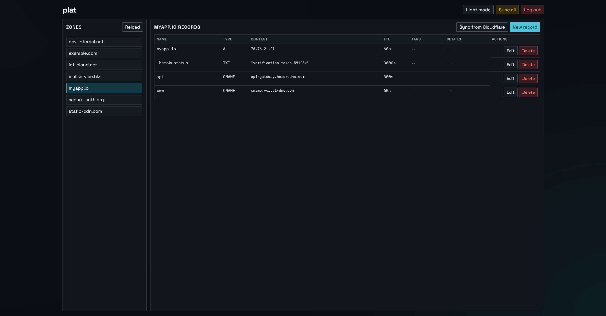
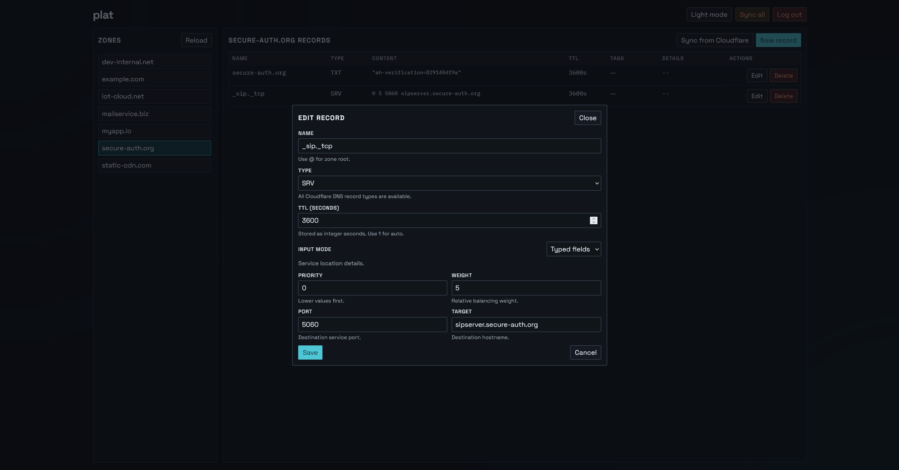
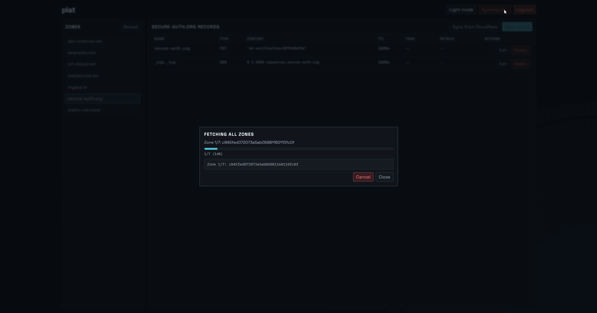

# plat

`plat` manages DNS zones and answers queries from its own records in `records.yml`. It works without Cloudflare; connect Cloudflare only if you want to import and sync Cloudflare zones. The name is from cadastral plats: clear maps of boundaries and lots; here, the same idea is applied to DNS zones and records.

## Installation

Download a pre-built release from the [releases page](https://github.com/coalaura/plat/releases/latest).

Building from source requires Go 1.27 or later for standard-library ML-DSA support.


*Browse zones and records in one view.*


*Edit records with typed fields for DNS record types.*


*Optionally sync Cloudflare zones with progress and logs.*

## Configuration

`config.yml` is created automatically on first run with defaults.

```yml
# enable verbose logging and diagnostics
debug: false

server:
  # port to run plat on (default: 8080)
  port: 8080
  # token for authentication, (default: "p4$$w0rd")
  token: p4$$w0rd

cloudflare:
  # optional cloudflare api token; leave empty to run plat on its own
  token: ""

dns:
  # enable built-in dns server (default: true)
  enabled: true
  # dns server port (default: 531)
  port: 531
  # optional hostname reserved for DoH; all other HTTP requests on this host are rejected
  domain: ""
  # optional ip fallback resolver for unknown queries (default: "9.9.9.9")
  fallback_ip: 9.9.9.9
  # optional DoH fallback resolver (default: "https://dns.quad9.net/dns-query")
  fallback_https: https://dns.quad9.net/dns-query
```

Set `dns.domain` to a hostname such as `dns.example.com` (without a scheme, port or path) to reserve that host for DNS-over-HTTPS. DoH GET and POST queries, typically sent to `/dns-query`, continue to work; every other request on that host returns `404`, including the panel, static files, management API, DynDNS and replication. The restriction also applies when `dns.enabled` is false, in which case all requests on that host are rejected. Other hosts keep their existing routing, including DoH support. Leaving `dns.domain` empty preserves the default shared-host behavior.

Matching uses the HTTP `Host` header, ignoring case, an optional port and a trailing dot. It matches only the configured hostname, not its subdomains. When using a reverse proxy, preserve the original `Host` header; `Forwarded` and `X-Forwarded-Host` do not override it. Use another hostname for the panel and for slave `master.address` replication URLs.

### Resolving the local hostname

Both master and slave automatically resolve their own OS hostname for queries whose source address is loopback or one of that machine's interface addresses. Matching ignores case and a trailing dot and uses the exact OS hostname, without adding short-name or domain aliases. Local queries take precedence over stored zones and fallback resolvers: A returns `127.0.0.1`, AAAA returns `::1`, ANY returns both and other record types return an empty successful response. These synthetic answers are unsigned and have a zero TTL. Other callers use normal zone and fallback resolution.

This applies to UDP/TCP DNS and direct DoH requests. DoH requests containing `Forwarded`, any `X-Forwarded-*` header, `X-Real-IP` or `Via` use normal resolution, regardless of header values. A reverse proxy must set a forwarding header on every request (for example, nginx `proxy_set_header X-Forwarded-For $remote_addr;`), because a local proxy that sends no forwarding headers is indistinguishable from a direct local client. Source-address checks identify the immediate DNS client; a local DNS forwarder also appears local.

The hostname and interface addresses are captured at startup without using DNS lookups. Restart the node after changing its hostname or interface addresses.

## Zones and Cloudflare

Sign in with `server.token` and select **New** in Zones to create a local zone. Add records there to serve them from plat's built-in DNS server or DNS-over-HTTPS endpoint. Local zones and their records are stored in `records.yml` and never sent to Cloudflare. You can delete a local zone after removing any DynDNS assignments to it.

Setting `cloudflare.token` enables Cloudflare zone import at startup and the existing sync controls. Cloudflare zones remain editable through plat; edits write through to Cloudflare when connected and **Sync** pulls records from Cloudflare. If Cloudflare is unreachable at startup, plat continues using saved zones and records. With no token, plat can still serve and edit saved zones locally; Cloudflare sync controls are unavailable.

## DNSSEC

Select a zone and open **DNSSEC** in the records toolbar. **Plat** is the default signing provider for both local zones and imported Cloudflare zones. Choose a signing algorithm, enter the nameservers that will serve the zone from plat and select **Enable DNSSEC**. The selector displays security and compatibility guidance for each algorithm. Plat generates a combined signing key (flags 257), publishes DNSKEY and RRSIG records and uses signed NSEC records for authenticated denial of existence. Responses support aliases, wildcards, empty non-terminals and signed or unsigned child delegations. Recursive resolvers use these records to validate the zone.

| Algorithm | Security rating | Security | Compatibility |
| --- | --- | --- | --- |
| **8 RSA/SHA-256** | **Strong (128-bit)** | 3072-bit RSA, approximately 128-bit classical security; not quantum-resistant. SHA-256 is the hash, not the key's security strength. | Long-established registrar and validator support, including older deployments. A useful compatibility choice, with larger keys and signatures than ECDSA/Ed25519. |
| **10 RSA/SHA-512** | **Strong (128-bit)** | 3072-bit RSA, approximately 128-bit classical security; not quantum-resistant. SHA-512 is the hash, not the key's security strength. | Broad validator support, but registrar support varies and signatures are larger than ECDSA/Ed25519. IANA does not recommend it for new signing. |
| **13 ECDSA/SHA-256** | **Strong (128-bit)** | P-256, approximately 128-bit classical security; not quantum-resistant. | Widely supported by registrars and validators; compact keys and signatures. |
| **14 ECDSA/SHA-384** | **Very strong (192-bit)** | P-384, approximately 192-bit classical security; not quantum-resistant. | Modern validator support; registrar support is less common than algorithm 13. |
| **15 Ed25519** | **Strong (128-bit)** | Approximately 128-bit classical security; not quantum-resistant. | Plat's default. Modern validator support, but some registrars do not accept it. |
| **16 Ed448** | **Very strong (224-bit)** | Approximately 224-bit classical security, the highest classical strength of these conventional choices; not quantum-resistant. | Less widely deployed than Ed25519 and ECDSA P-256; confirm registrar and validator support. Public keys are 57 bytes and signatures are 114 bytes. |
| **18 ML-DSA-44** | **Quantum-resistant** | Post-quantum, NIST security category 2; not directly comparable to classical bit-strength ratings. | Newly assigned DNSSEC algorithm with limited registrar and validator support. Public keys are 1,312 bytes and signatures are 2,420 bytes, often requiring DNS over TCP. |

For classical security, choose the highest supported rating: **224-bit > 192-bit > 128-bit**. **Quantum-resistant** denotes protection against quantum attacks, not a higher classical bit-strength rating; it requires algorithm 18 support end-to-end. Algorithms with equivalent strength share a rating, regardless of their hash names. **Ed25519 (15)** remains the default.

Confirm that your registrar or parent-zone operator accepts DS records for your selected algorithm and that your validating resolvers support it. Plat cannot discover or guarantee that external support; a validator that does not support the algorithm cannot authenticate its signatures. ML-DSA-44 uses pure ML-DSA with an empty context as specified by the [DNSSEC ML-DSA-44 specification](https://www.ietf.org/archive/id/draft-westerbaan-dnssec-mldsa-03.html), currently an Internet-Draft referenced by the [IANA algorithm registry](https://www.iana.org/assignments/dns-sec-alg-numbers/dns-sec-alg-numbers.xhtml). DS digests use SHA-256 (digest type 2) for every signing algorithm.

The modal exposes copyable **DS Record**, **Digest**, **Digest Type**, **Algorithm**, **Public Key**, **Key Tag**, **Flags**, **Protocol** and **DNSKEY Record** values. The DS uses SHA-256 (digest type 2). Signing status means signatures are being served; it does not assert that public delegation and the parent DS have been configured or validated.

For public DNSSEC, configure your registrar's nameserver delegation to point to servers running plat, provide registrar glue and matching A/AAAA records when the nameservers are inside the zone and make those servers reachable on **UDP and TCP port 53**. Plat's default DNS port is 531; change `dns.port` to 53 or arrange forwarding for both transports. Each authoritative server must serve the same signed zone and keys. Once delegation is ready, publish the displayed DS through the registrar or parent-zone operator. The DS belongs in the **parent zone**, not at the signed zone's own apex. Remove any DS for a previous signer as part of a coordinated migration; all delegated servers must match the published DS during the transition.

Plat supplies the configured apex NS records and generates an SOA when none is present. Generated DNSSEC records are served automatically rather than inserted into the editable records table. Imported records continue using Cloudflare's existing edit/sync behavior, while plat supplies its own signatures when selected as signer.

Keys and per-zone settings are saved atomically with records in `data/records.yml`, with owner-only file permissions where supported and excluded from Git. Existing `data/dnssec.yml` settings are loaded compatibly and migrated with committed records; include both files in backups while upgrading. Losing the private key requires a new key and a parent DS change. Signatures have a 14-day validity period and refresh on demand after 24 hours, including after a period without queries. Record edits, deletions, DynDNS updates and Cloudflare sync invalidate the signed snapshot immediately. Signature renewal does not change the authoritative SOA serial. The signing key remains stable across restarts and disable/re-enable cycles with the same algorithm so the parent DS remains stable. To change algorithms, remove the parent DS, wait for cached copies to expire, disable DNSSEC, then re-enable with the new algorithm and publish the new DS. Algorithm changes generate a new key and cannot be made while signing is enabled.

For a connected Cloudflare zone, choose **Cloudflare** to inspect existing Cloudflare DNSSEC, enable it and copy its registrar values. The Cloudflare API token needs **Zone DNS Settings: Read/Write** and access to the zone. Cloudflare manages its own signing keys; plat relays queries for a Cloudflare-signed zone to Cloudflare's authoritative nameservers. Keep the public delegation pointed to Cloudflare in this mode.

Before disabling DNSSEC, remove the parent DS and allow its cached copies to expire, then confirm this in the modal. Disable the current provider before switching providers or deleting a signed local zone. Plat retains its key when disabled.

Authenticated management endpoints are `GET /-/{zone}/dnssec` and `PUT /-/{zone}/dnssec`. GET accepts `?provider=plat` or `?provider=cloudflare` to inspect a provider. PUT accepts `enabled`, `provider`, `algorithm`, `nameservers` and `parent_ds_removed`; `algorithm` is an optional number (`8`, `10`, `13`, `14`, `15`, `16` or `18`) for plat signing. Omitting it preserves the retained key's algorithm or defaults to Ed25519 (15) for a new key. Cloudflare manages its own algorithm and rejects an explicit selection. Private signing keys are never returned by the API.

## Clustering

Use the separate `plat-slave` binary for read-only DNS replicas with their own HTTPS termination. Each binary generates its own certificates and private keys on first start; authorize replication by exchanging only the public certificates. Replication shares the master's existing HTTP/HTTPS port through an end-to-end authenticated WebSocket tunnel, so no extra replication port or firewall rule is needed. See [master/slave setup](docs/clustering.md) for the first-run steps, configuration, checkpoint recovery and asynchronous replication guarantees. Existing standalone deployments require no cluster configuration.

## License

GPL-3.0 (see `LICENSE`).
